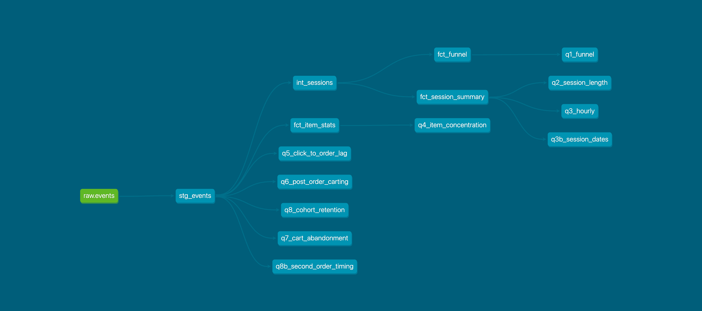

# OTTO cold-start session recommender


**[Live demo →](https://otto-cold-start-recsys-ft3tnvzxfcvbx97qsmbgw9.streamlit.app/)** — a stakeholder walkthrough of the analysis behind a ship decision: problem, funnel diagnostics, model bake-off, and the off-policy evidence for shipping.

> CI runs the pipeline on a 2,000-session synthetic fixture on every push. It validates pipeline integrity — parsing, loading, dbt models and tests — not model quality or full-scale performance. Every result below comes from real OTTO data.

## The pitch

Recommending on a long-tail catalog with no product metadata and no logged randomized experiments: 200k real e-commerce sessions go through dbt models → product analytics → three session-based recommenders compared on a time-based split → item embeddings with similarity search → a causal off-policy evaluation of the ship decision. The offline evidence says **ship co-visitation to a live experiment** — ~15x the popularity baseline on the business-weighted metric, with the OPE confidence interval entirely above zero.

## Repo map

```
app/                  Streamlit demo (app.py + precomputed assets/ — no training at serve time)
dbt/                  models: staging → intermediate → marts; analyses/; 14/14 tests passing
src/recsys/           pipeline scripts: sample → train → bake-off → OPE → export assets
docs/                 findings, bake-off, OPE results, experiment design, data dictionary, session logs
scripts/              synthetic data fixture generator (CI only)
.github/workflows/    CI: pipeline integrity on synthetic data, every push to main
Makefile              one-command pipeline runner (make all)
```

## Data

- **OTTO – Multi-Objective Recommender System**: 12.9M real e-commerce sessions (Jul–Aug 2022). Events are clicks, carts, and orders — there is **no product metadata** (no titles, no categories), so all similarity is behavioral.
- This project uses a **200,000-session sample** (10.3M events: 9.3M clicks / 752k carts / 213k orders). See `docs/data-dictionary.md`.
- Dataset by OTTO (GmbH & Co KG) via Kaggle, used under **CC-BY 4.0**: https://www.kaggle.com/competitions/otto-recommender-system
- Raw data is **not redistributed** (gitignored, local only). The repo contains code, docs, and derived aggregates only.

## Methods

**dbt layers** (DuckDB; run from `dbt/`): `stg_events` (raw JSONL → typed events) → `int_sessions` (sessionization) → marts `fct_session_summary`, `fct_item_stats`, `fct_funnel`. 14/14 data tests pass.



**Three recommenders**, compared on a time-based 80/20 split (train on older sessions, test on newer — no leakage): predict each test session's last event from its history, scored with Recall@20 and MRR@20 per event type, blended with business weights 1/5/20 (click/cart/order — documented judgment, never tuned).
- *Popularity*: global most-clicked — no personalization.
- *Co-visitation*: for each viewed item, the items most often co-occurring in the same sessions ("viewed this → viewed that").
- *item2vec*: skip-gram embeddings (dim 64, window 5, min_count 5, 5 epochs, seed 42); nearest neighbors by cosine.

**Off-policy evaluation** (the ship decision, honestly simulated): rewards click 0.1 / cart 0.3 / order 1.0. Logging policy π_pop = softmax over popularity (temperature solved so the top-100 items take exactly 80% of impressions); candidate π₁ = ε-greedy (ε=0.05, K=20) over co-visitation. Attempt 1 (pure-popularity log) was degenerate — 2–4/40,000 matches, no overlap — which is itself the lesson: CIs quantify noise, not design flaws. Attempt 2 (50/50 pilot mixture) gives 67 informative impressions with all importance weights ≤ 2.0 by construction.

## Results

| model | Clicks R@20 | Weighted R@20 |
|---|---|---|
| popularity | 0.0044 | 0.0021 |
| **co-visitation** | **0.0647** | **0.0328** |
| item2vec | 0.0257 | 0.0133 |

(Full per-event-type table in `docs/model-bakeoff.md`.)

- **The upset: co-visitation beats item2vec.** Diagnosis, not hand-waving: OTTO "sessions" are multi-day visitor histories (median 4.2 days first-click → order), which breaks skip-gram's short-window assumption; hyperparameters were also untuned. Orders are ~unpredictable for all three models — a task-framing result, not a tuning failure.
- **OPE (attempt 2):** IPS lift **+3.04e-04** per impression, 95% CI [2.13e-04, 4.03e-04]; doubly robust +3.05e-04 with a nearly identical CI — both estimators agree, CI entirely above zero. Expected reward ~11x the popularity policy's. Max importance weight 2.0 (bounded by the mixture design).
- **Analytics that shaped the models:** the top item by orders is 0.15% of all orders (extreme long tail — popularity is hopeless); conversion rises monotonically with session length; 47% cart abandonment with abandoners deliberating ~12 days (re-engagement audience); true next-day repurchase is only ~24% of buyers — 59% of "second orders" are same-checkout multi-item baskets, correcting the naive 52%. Details in `docs/analytics-findings.md`.
- **Recommendation: SHIP** — promote co-visitation to a live experiment. Design doc with power analysis: `docs/experiment-design.md`.

## Limitations

- 200k-session sample covers only the first ~9 hours of the file — hourly patterns are inconclusive; sample kept, limitation documented.
- No product metadata: all similarity is behavioral.
- "Sessions" are multi-day histories, not single visits.
- OPE propensities are simulated — OTTO never ran this as a bandit experiment, so this is directional evidence, not a substitute for a live test.
- Orders are essentially unpredictable from session history for every model tested.
- item2vec hyperparameters untuned; weights 1/5/20 are judgment, not tuned.
- CI validates plumbing on synthetic data, not model quality.

## Reproduce it

```bash
# Python 3.11
uv venv
uv pip install duckdb dbt-duckdb pandas pyarrow gensim streamlit
# Download train.jsonl from the Kaggle competition (accept the rules first) into data/raw/
# Point your dbt profile (~/.dbt/profiles.yml) at $PWD/data/warehouse.duckdb
make all                  # sample → dbt → train → bake-off → OPE → similarity → demo assets
streamlit run app/app.py  # local demo
```

`make clean && make all` rebuilds everything from raw data. Each `Makefile` target maps to one pipeline stage; CI runs the same stages through `dbt build` on the synthetic fixture.

## What I'd do next

- **Recency-weighted sequential model** (e.g., SASRec): the multi-day session finding says recent behavior should dominate — test it directly.
- **Full 12.9M-session run** on bigger compute; check the upset survives scale.
- **Live A/B test** per `docs/experiment-design.md` — the OPE says it's worth running.
